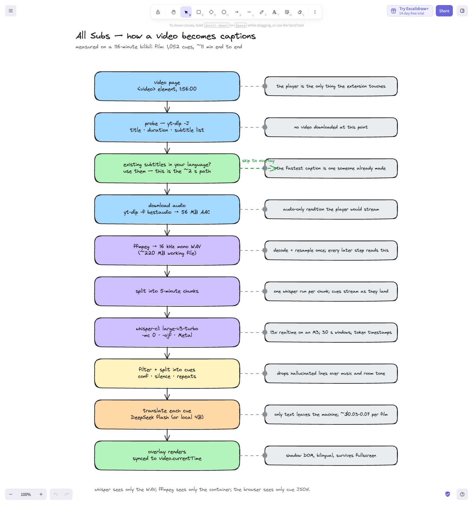

# All Subs

**Subtitle recovery and AI captions for web video (macOS + Chrome).** It checks for usable
existing subtitles first — YouTube tracks, site-native tracks, or public subtitle libraries —
and only falls back to transcribing and translating when nothing usable exists.


Built because a Chinese film on bilibili.tv had no subtitle track and I wanted to watch
it that night.

## How routing actually works

Every request checks existing subtitles first (cheapest and fastest). Only when no usable
track exists — or when you click **Use AI instead** — does it run the generation mode you
selected in the panel:

| route | when it runs | what happens | typical time & cost |
|---|---|---|---|
| **1. retrieve** | always first (unless *Use AI instead*) | YouTube track → site-native track → Wikidata + IMDb + Wyzie library, gated on runtime coverage | **~2–8 s**, free |
| **2. This Mac (default AI)** | no usable track + **This Mac** selected | local `whisper.cpp` ASR on Apple Silicon + DeepSeek translation on compact cue text | **11–17 min** for 116 min · **~$0.02–0.04** (prefix-cached) |
| **3. Cloud (opt-in)** | no usable track + **Cloud** selected | 32 kbps MP3 chunks → multimodal model (OpenRouter/Gemini Flash); fails over to local whisper on error | **~4.9 s / 60 s clip** · **~$0.30/film** |
| **4. Offline (experimental)** | **This Mac** + *Translate offline* checked (16 GB+ RAM) | `whisper.cpp` + local Qwen3-4B via `llama.cpp` | slower, free, 100% offline |

The gates matter as much as the models: a retrieved library track must plausibly span the
film (70–105% of runtime — my first lookup returned a different film's subtitles ending 22
minutes after the credits), silent chunks skip Whisper entirely, a music/speech-rate gate
rejects whisper hallucinations over background music, and the overlay badge always tells you
which route answered (*YouTube subs*, *official subs*, *library subs*, *cloud subs*, or *AI subs*).

## What leaves your machine

Nothing runs on an All Subs server — there is no hosted backend. What leaves your Mac
depends strictly on the route used:

| route | leaves your Mac | stays local |
|---|---|---|
| **YouTube / site-native track** | nothing (or cue text to DeepSeek only if translating to another language) | audio, video |
| **Subtitle library (Wyzie)** | cleaned title + year to Wikidata; IMDb ID + target language to Wyzie | audio, video |
| **This Mac (local ASR)** | cue text only to DeepSeek (`api.deepseek.com`) | audio, video, Whisper model |
| **Cloud mode (opt-in)** | compressed 32 kbps mono audio chunks to OpenRouter (`openrouter.ai`) | video |
| **Offline mode (experimental)** | nothing | everything |

## Architecture

```
Chrome extension (zero-idle-CPU overlay) ──► local engine (127.0.0.1:8765)
  MutationObserver + ResizeObserver            1. YouTube track / page probe (yt-dlp)
  requestVideoFrameCallback while playing      2. library lookup: title+year → Wikidata → Wyzie → coverage gate
  gzipped cue pages                            3. lazy pipelined chunking (30s/90s/180s/300s) + silent-chunk skip
                                               4. whisper.cpp + fast onset snapping + music/loop filter
                                               5. prefix-cached compact batch translation (keep-alive HTTPS)
                                               6. optional deep pass: synopsis + glossary + register → parallel refine
```



## Quick start (macOS)

```bash
git clone https://github.com/mattdani21/all-subs.git
cd all-subs
./allsubs setup            # installs ffmpeg, yt-dlp, whisper-cpp + 1.5 GB speech model
./allsubs start            # starts local engine on 127.0.0.1:8765
```

> **Retrieval-first / Cloud-only fast install:** run `./allsubs setup --lite` to skip the
> 1.5 GB Whisper download until you actually need local transcription (`./allsubs model`
> pulls it later).

Load the Chrome extension once:

1. Open `chrome://extensions` → enable **Developer mode**
2. Click **Load unpacked** → select `extension/`
3. Open a video page and click **AS** (or press `Alt+Shift+A`)

Add API keys in the extension's **Settings** page (stored locally at `~/.allsubs/config.json`
with `0600` permissions) or in `.env` (see `.env.example`):

- `DEEPSEEK_API_KEY` — translation on the local ASR path
- `WYZIE_API_KEY` — optional, free at `store.wyzie.io/redeem` (1,000 lookups/day) for subtitle library retrieval
- `OPENROUTER_API_KEY` — optional, enables opt-in **Cloud** mode

Run `./allsubs doctor` at any time to verify binaries, model, keys, and engine status.

## Tested compatibility

| site / source | retrieval | AI generation | notes |
|---|---|---|---|
| **bilibili.tv** | library (Wyzie) | verified (116-min film) | primary test target |
| **YouTube** | native & auto captions (~2 s) | best-effort (`yt-dlp` may hit bot check) | cookies are opt-in: `ALLSUBS_YOUTUBE_COOKIES=1` |
| **Direct MP4 / HLS (`.m3u8`)** | site track / library | supported | extension sniffs stream URL in top & iframe players |
| **Local video files** | — | via `test/player.html` | useful for offline testing |
| **DRM (Netflix, Prime, Disney+)** | not supported | not supported | encrypted streams are out of scope |

## Speed, efficiency & cost

Measured on a 116-minute film (M3 MacBook Air, 8 GB RAM):

| path | time | notes |
|---|---|---|
| library track (after panel prefetch) | **~0.01 s** | prefetched while the panel is open |
| library track (cold) | **~8 s** | Wikidata → Wyzie → coverage gate |
| YouTube native captions | **~2 s** | no audio download |
| first AI caption (dialogue opening) | **~20 s** | 30 s opening chunk via section download |
| full local ASR + translation | **11–17 min** | Whisper Metal is ~94% of wall time |
| repeat view | **instant** | cached by URL + target in `~/.allsubs/cache` |

Efficiency details in v0.4.0:
- **Cheaper translation:** static film context (title, synopsis, register, sorted glossary) lives in the system prompt for DeepSeek prefix caching; cues use compact key→text JSON (~40% fewer input tokens), larger batches (60 lines) with auto-halving recovery, non-verbal line skipping, keep-alive HTTPS, and fail-fast 4xx model fallback.
- **Faster audio pipeline:** lazy pipelined chunk slicing, silent-chunk skipping before Whisper, 2-window early-exit language detection, C-speed cue-window onset snapping, and automatic cleanup of temporary chunk WAVs.
- **Zero idle browser CPU:** the overlay uses `ResizeObserver` + `requestVideoFrameCallback` only while playing with cues loaded (0 rAF frames when idle or paused), and content script video discovery is event-driven via `MutationObserver`.

## Controls

- `Alt+Shift+A` — open/close the panel
- **Bilingual** — show the original line above the translation
- `−0.1s` / `+0.1s` / `0s` — nudge or reset subtitle timing (saved per site)
- **Check sync** — listens to three 30 s audio samples with strict one-to-one cue matching (±30 s window) and shifts same-language tracks only when genuinely out of sync
- **Use AI instead** — bypass a retrieved track for the current video without changing your global defaults
- **Re-sync** — refetch cues from the engine

## CLI & release artefacts

```bash
./allsubs setup [--lite]   # install dependencies (and optionally skip the 1.5 GB model)
./allsubs model            # download the whisper large-v3-turbo model on demand
./allsubs doctor           # verify python, ffmpeg, whisper-cli, yt-dlp, model, keys, engine
./allsubs start|stop|status|logs
./allsubs test             # compile check + unit test suite
./allsubs clean            # remove stale temporary job workdirs and show cache size
./allsubs package          # build dist/AllSubs-<ver>.zip, dist/AllSubs-extension-<ver>.zip, SHA256SUMS.txt
```

`./allsubs package` produces three clean release artefacts in `dist/`:
1. `AllSubs-<ver>.zip` — curated source release (engine, extension with icons, CLI, tests, license; no internal dev notes or secrets).
2. `AllSubs-extension-<ver>.zip` — standalone Chrome Web Store package (`extension/` contents at zip root).
3. `SHA256SUMS.txt` — SHA-256 checksums for release verification.

## API (local engine)

| Method | Path | Purpose |
|---|---|---|
| `GET` | `/health` | engine version, binaries, model, key presence, RAM |
| `GET`/`POST` | `/api/config` | read setup state / save API keys (`0600`) |
| `POST` | `/api/jobs` | `{url, target, mode, duration, asr, translator, force}` |
| `GET` | `/api/jobs/{id}` | status, stage, progress, track provenance, token/cost usage |
| `GET` | `/api/jobs/{id}/cues?from=N` | paginated cues `{i,s,e,x,t}` (gzip-compressed) |
| `POST` | `/api/jobs/{id}/refine` | run the whole-film synopsis/glossary pass |
| `POST` | `/api/jobs/{id}/align` | one-to-one content-matched sync check |
| `GET` | `/api/jobs/{id}.vtt` | WebVTT export |

## Known limits

- macOS-first (Apple Silicon Metal for `whisper.cpp`). Linux should work; Windows has no install path yet.
- Overlay cannot attach to a bare `<video>` element in fullscreen (only container fullscreen).
- Library subtitles occasionally come from a different cut; use **Check sync**, `±0.1s`, or **Use AI instead**.
- Alpha quality: unsigned local engine, unpacked extension (Chrome Web Store listing prepared in `CHROMEWEBSTORE.md`).

## Layout

```
allsubs                CLI: setup, model, doctor, start/stop, test, clean, package
engine/captions.py     probe, native/YouTube subs, audio, whisper, sync, prefix-cached LLM
engine/providers.py    Wikidata → IMDb → Wyzie resolver + coverage gate
engine/cloud_asr.py    opt-in multimodal cloud chunk captioning (32 kbps MP3, retries)
engine/local_llm.py    experimental offline translation via llama.cpp
engine/server.py       stdlib ThreadingHTTPServer API, gzip, job runner, cache
extension/             MV3 Chrome extension: icons, overlay.js, content.js, options, popup
test/                  unit tests, local player harness, Playwright e2e scripts
```

## Licence

MIT. The film in the screenshot is *Shadow* (2018), used only to demonstrate the tool.
