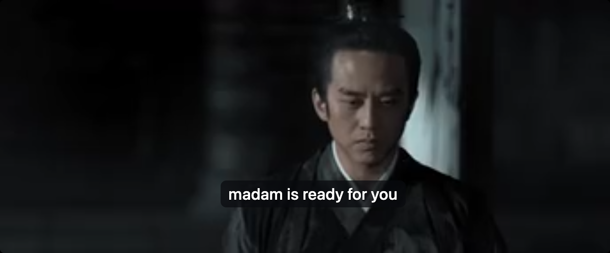
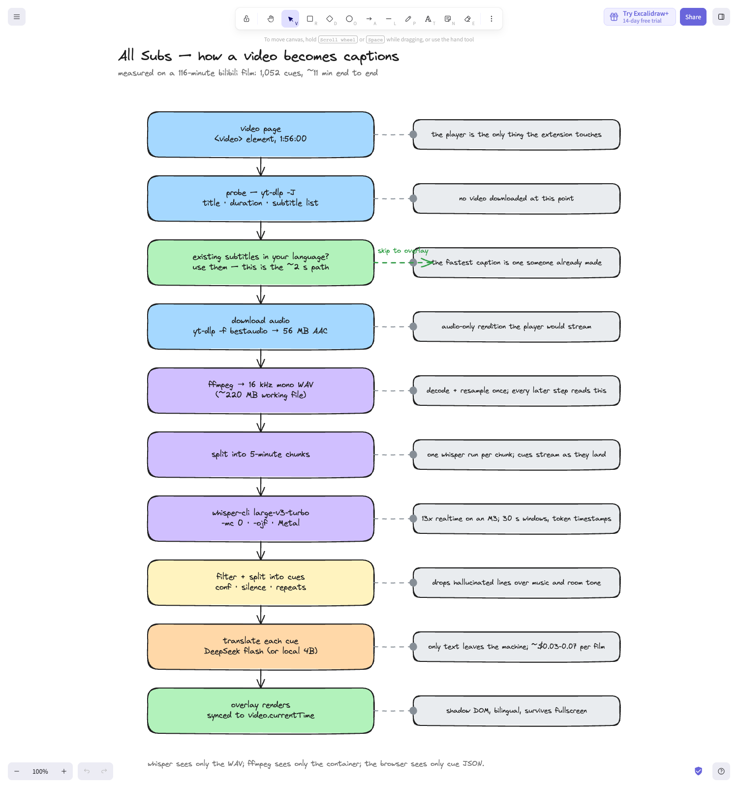

# All Subs

**AI captions for any video.** It looks for existing subtitles first — usually in
seconds — and only when nothing usable exists does it transcribe the audio locally with
whisper.cpp and translate it with an LLM.



Built because a Chinese film on bilibili.tv had no subtitle track and I wanted to watch
it that night.

## It's a router

Every request walks three rungs, cheapest first, and only falls through when the rung
above fails its gate:

| rung | what happens | measured |
|---|---|---|
| **1. retrieve** | existing track via Wikidata → IMDb → Wyzie | **~8 s**, 1,072 cues |
| **2. generate** | whisper.cpp + DeepSeek when nothing usable exists | 11–17 min for 116 min |
| **3. local** | Qwen3-4B on the machine, nothing leaves it | fine on 16 GB+, too slow on 8 GB |

The gates are the product: a retrieved track must span the film (my first one ran 22
minutes past the credits), generation needs a translation key, local needs RAM. The
overlay badge tells you which rung answered — *library subs*, *AI subs*, or *official*.

## How it works

```
Chrome extension  ──►  local engine (127.0.0.1:8765)
  finds <video>          1. probe: title, duration, subtitle inventory
  draws overlay          2. library lookup: title+year → IMDb → Wyzie → sync gate
  polls cues             3. nothing usable → download audio → 16 kHz mono → whisper.cpp
                         4. chunked ASR (60s/120s/300s) → cues stream as they land
                         5. LLM translates while the next chunk transcribes
                         6. optional deep pass: whole transcript → synopsis + glossary
                            → every cue re-translated with that context
```



Everything heavy runs on your machine; only cue text goes to the translation API. Jobs are
cached by URL + language, so a second viewing is instant.

## Quick start (macOS)

```bash
git clone https://github.com/mattdani21/all-subs.git
cd all-subs
./allsubs setup     # ffmpeg, whisper-cpp, yt-dlp + the 1.5 GB speech model
./allsubs start     # engine on 127.0.0.1:8765
```

Chrome → `chrome://extensions` → Developer mode → **Load unpacked** → `extension/`.
Open a video and hit **AS** (or `Alt+Shift+A`).

Add keys in the extension's **Settings** page, or drop them in `~/AllSubs/.env`:

- `DEEPSEEK_API_KEY` — translation (required for the generate path)
- `WYZIE_API_KEY` — subtitle library (optional, free at store.wyzie.io/redeem, 1,000/day)

`./allsubs doctor` reports exactly what is missing.

## Speed, measured

116-minute film on an M3 (8 GB):

| path | time |
|---|---|
| library subtitles found | **~8 s** |
| full ASR + translation | ~11–17 min (depends on machine load) |
| repeat view | instant (cached) |

ASR is the floor: whisper large-v3-turbo runs ~7–13× realtime and accounts for 94–97% of
wall time. Greedy decoding, quantised models, flash attention and parallel chunks were all
measured — none move it much. The only real win is not transcribing, which is why the
library path exists.

## What it is not

- Not a hosted service. There is no server; the engine runs on your Mac.
- Not DRM-capable. It captions video you can already fetch, not Netflix.
- Not silent about failure: the panel distinguishes engine offline, missing model,
  missing key, and rejected subtitle tracks.

## Limits

- macOS-first. Engine is stdlib Python + brew binaries; Linux should work, Windows has no
  install path yet.
- `yt-dlp` is refused by YouTube's bot check; bilibili and direct video hosts work.
- Overlay can't attach to a bare `<video>` in fullscreen — only container fullscreen.
- Library subtitles occasionally come from a different release; the duration gate catches
  the obvious mismatches, not every offset. Use `−0.3s` / `+0.3s`.
- Alpha quality: unsigned, no auto-update.

## Controls

- `Alt+Shift+A` — open/close the panel
- Bilingual — original line above the translation
- `−0.3s` / `+0.3s` — timing nudge
- Re-sync — refetch cues (after the deep pass rewrites them)

## API (engine)

| Method | Path | Purpose |
|---|---|---|
| GET | `/health` | engine, model, keys, RAM |
| GET/POST | `/api/config` | read setup state / store keys (written 0600) |
| POST | `/api/jobs` | `{url, target, mode, duration}` |
| GET | `/api/jobs/{id}` | status, stage, progress |
| GET | `/api/jobs/{id}/cues?from=N` | `{i,s,e,x,t}` |
| POST | `/api/jobs/{id}/refine` | re-run the whole-film pass only |
| GET | `/api/jobs/{id}.vtt` | WebVTT export |

## Offline mode (experimental)

`./allsubs local-model` pulls Qwen3-4B (~2.5 GB) and the panel gains an offline toggle.
Whisper runs first, then llama-server, so the two never share RAM. Fits 16 GB+; on an
8 GB machine it is CPU-only and impractically slow. Cloud translation stays the default.

## Layout

```
engine/captions.py    probe, native subs, audio, whisper, translation
engine/providers.py   Wikidata → Wyzie resolution + sync gate
engine/server.py      HTTP API, job runner, cache
engine/local_llm.py   offline translation via llama.cpp
extension/            MV3: overlay.js, content.js, options, popup
test/                 unit tests, local harness, Playwright e2e
```

## Licence

MIT. The film in the screenshot is *Shadow* (2018), used only to demonstrate the tool.
