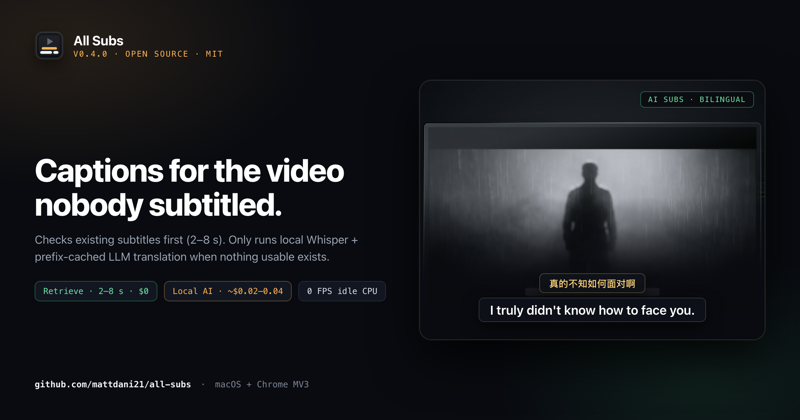
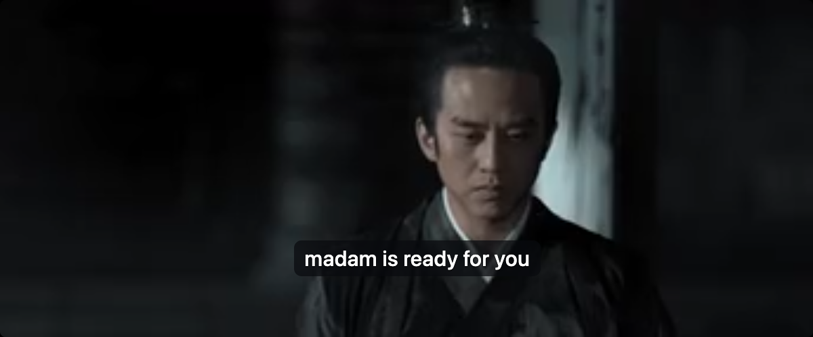
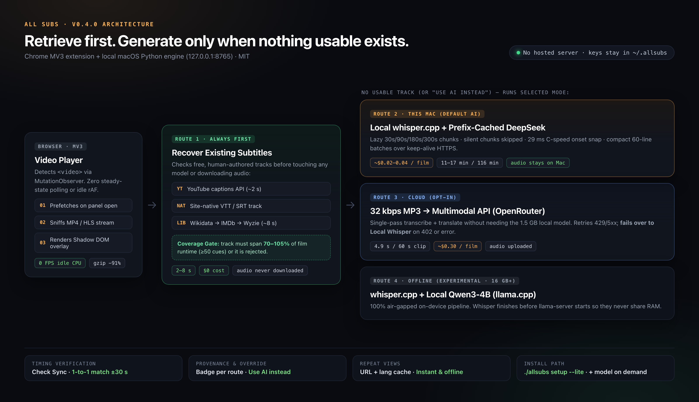
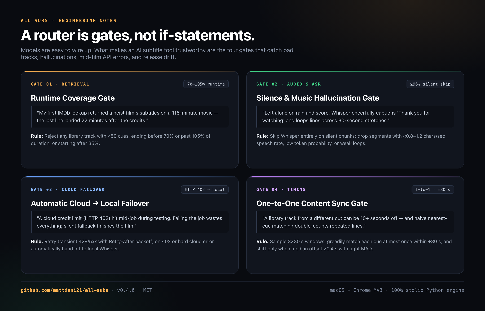
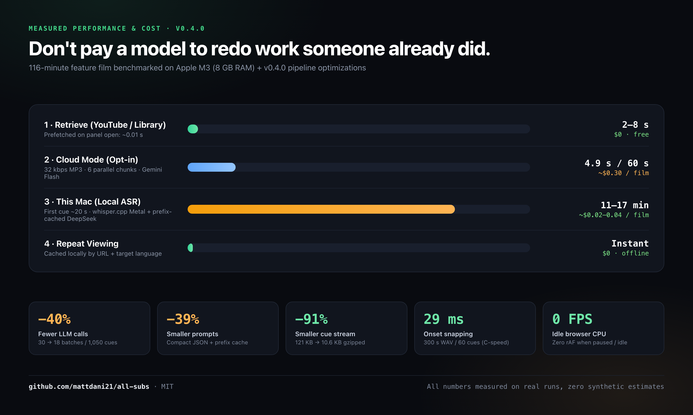

<div align="center">



<br><br>

[](https://github.com/mattdani21/all-subs/actions/workflows/ci.yml)
[](https://github.com/mattdani21/all-subs/releases/latest)
[](LICENSE)
[](#quick-start-macos)
[](#layout)

**Subtitle recovery and AI captions for web video.**
Checks usable existing subtitles first (2–8 s, free) — only transcribes and translates when nothing usable exists.

[Live Page](https://mattdani21.github.io/all-subs/) · [Latest Release](https://github.com/mattdani21/all-subs/releases/latest) · [Quick Start](#quick-start-macos) · [Privacy](#what-leaves-your-machine) · [API](#api-local-engine)

</div>

---

Built because a 116-minute Chinese film on bilibili.tv had no subtitle track and I wanted to watch it that night.

<p align="center">
  
  <br>
  <sub>A retrieved subtitle track rendered live over <em>Shadow</em> (2018) via the Shadow DOM overlay.</sub>
</p>

## Architecture — retrieve first, generate only when needed

Every request checks existing subtitles first (cheapest, fastest, human-authored). Only when no usable track exists — or when you click **Use AI instead** — does it run the AI mode selected in the panel:

<p align="center">
  
</p>

| Route | When it runs | What happens | Measured time & cost |
|---|---|---|---|
| **1 · Retrieve** | Always first (unless *Use AI instead*) | YouTube track → site-native track → Wikidata + IMDb + Wyzie library, gated on 70–105% runtime coverage | **2–8 s** (`~0.01 s` prefetched) · **$0** |
| **2 · This Mac** *(default AI)* | No usable track + **This Mac** selected | Local `whisper.cpp` (Apple Silicon Metal) + prefix-cached DeepSeek translation on compact cue text | **11–17 min** / 116 min · **~$0.02–0.04** |
| **3 · Cloud** *(opt-in)* | No usable track + **Cloud** selected | 32 kbps mono MP3 chunks → multimodal model (OpenRouter / Gemini Flash); fails over to local Whisper on error | **4.9 s / 60 s clip** · **~$0.30/film** |
| **4 · Offline** *(experimental)* | **This Mac** + *Translate offline* (16 GB+ RAM) | `whisper.cpp` + local Qwen3-4B via `llama.cpp` | slower · **$0** · 100% offline |

## Why the gates matter more than the models

<p align="center">
  
</p>

The overlay badge always shows which route answered (*YouTube subs*, *official subs*, *library subs*, *cloud subs*, or *AI subs*), and **Use AI instead** lets you override any retrieved track for that video without changing your defaults.

## Speed, efficiency & cost

<p align="center">
  
</p>

What makes v0.4.0 fast, lean, and cheap:

- **Prefix-cached compact translation** — deterministic film context (`FILM`, `SYNOPSIS`, `REGISTER`, sorted `GLOSSARY`) lives in the `system` prompt for DeepSeek automatic context caching; compact key→text JSON batches (`batch=60` with auto-halving recovery) cut API calls **40%** (`30 → 18` per 1,050 cues) and prompt payloads **39%**, skip non-verbal lines, reuse keep-alive HTTPS connections, and fail fast on `4xx` errors.
- **Lean audio & ASR pipeline** — lazy pipelined chunk slicing (`30s / 90s / 180s / 300s`), silent-chunk skipping before Whisper (`≥96%` silence), 2-window early-exit language detection, **29 ms** C-speed cue-window onset snapping, and automatic cleanup of temporary chunk WAVs/JSONs.
- **Zero idle browser CPU** — the Shadow DOM overlay uses `ResizeObserver` + `requestVideoFrameCallback` *only* while playing with cues loaded (**0 FPS** when idle or paused), content script video discovery is event-driven via `MutationObserver`, and `/cues` streams with `gzip` (**91% smaller**: `121 KB → 10.6 KB`).

## Quick start (macOS)

```bash
git clone https://github.com/mattdani21/all-subs.git
cd all-subs
./allsubs setup            # installs ffmpeg, yt-dlp, whisper-cpp + 1.5 GB speech model
./allsubs start            # starts local engine on 127.0.0.1:8765
```

> **Retrieval-first / Cloud-only fast install:** run `./allsubs setup --lite` to skip the 1.5 GB Whisper download until you need local transcription (`./allsubs model` pulls it later).

Load the Chrome extension once:

1. Open `chrome://extensions` and enable **Developer mode**
2. Click **Load unpacked** and select `extension/`
3. Open a video page and click **AS** (or press `Alt+Shift+A`)

Configure API keys in the extension's **Settings** page (saved locally to `~/.allsubs/config.json` with `0600` permissions) or in `.env` (see [`.env.example`](.env.example)):

- `DEEPSEEK_API_KEY` — translation on the local ASR path
- `WYZIE_API_KEY` — optional, free at `store.wyzie.io/redeem` (1,000 lookups/day) for subtitle library retrieval
- `OPENROUTER_API_KEY` — optional, enables opt-in **Cloud** mode

Run `./allsubs doctor` at any time to verify binaries, model, keys, and engine health.

## What leaves your machine

There is no hosted All Subs backend, no account, and no analytics. What leaves your Mac depends strictly on the route used:

| Route | Sent off-device | Stays on your Mac |
|---|---|---|
| **YouTube / site-native track** | Nothing (cue text to DeepSeek only if translating to another language) | Audio & video |
| **Subtitle library (Wyzie)** | Cleaned title + year to Wikidata; IMDb ID + target language to Wyzie | Audio & video |
| **This Mac (local ASR)** | Cue text only to DeepSeek (`api.deepseek.com`) | Audio, video & Whisper model |
| **Cloud mode (opt-in)** | Compressed 32 kbps mono audio chunks to OpenRouter (`openrouter.ai`) | Video |
| **Offline mode (experimental)** | Nothing | Everything |

## Tested compatibility

| Site / source | Retrieval | AI generation | Notes |
|---|---|---|---|
| **bilibili.tv** | Library (Wyzie) | Verified (116-min film) | Primary test target |
| **YouTube** | Native & auto captions (~2 s) | Best-effort (`yt-dlp` bot checks) | Cookies opt-in via `ALLSUBS_YOUTUBE_COOKIES=1` |
| **Direct MP4 / HLS (`.m3u8`)** | Site track / library | Supported | Sniffs stream URL in top & iframe players |
| **Local video files** | — | Via `test/player.html` | Useful for offline testing |
| **DRM (Netflix, Prime, Disney+)** | Not supported | Not supported | Encrypted streams are out of scope |

## Controls

- `Alt+Shift+A` — open or close the caption panel
- **Bilingual** — show original-language captions above the translation
- `−0.1s` / `+0.1s` / `0s` — nudge or reset subtitle timing (saved per site)
- **Check sync** — samples 3×30 s of audio with strict 1-to-1 cue matching (`±30 s` window) and shifts same-language tracks only when genuinely out of sync
- **Use AI instead** — bypass a retrieved track for the current video
- **Re-sync** / **download `.vtt`** — refetch cues or export WebVTT

## CLI & release artefacts

```bash
./allsubs setup [--lite]   # install dependencies (optionally skip the 1.5 GB model)
./allsubs model            # download the whisper large-v3-turbo model on demand
./allsubs doctor           # verify python, ffmpeg, whisper-cli, yt-dlp, model, keys, engine
./allsubs start|stop|status|logs
./allsubs test             # compile check + 17 unit & HTTP integration tests
./allsubs clean            # remove stale temporary job workdirs and show cache size
./allsubs package          # build release ZIPs + SHA256SUMS.txt in dist/
```

Every GitHub release includes three verified artefacts:

1. `AllSubs-<ver>.zip` — curated source release (engine, extension with icons, CLI, tests, license)
2. `AllSubs-extension-<ver>.zip` — standalone Chrome Web Store bundle (`extension/` at zip root)
3. `SHA256SUMS.txt` — SHA-256 checksums for verification

## API (local engine)

| Method | Path | Purpose |
|---|---|---|
| `GET` | `/health` | engine version, binaries, model, key presence, RAM |
| `GET`/`POST` | `/api/config` | read setup state / save API keys (`0600`) |
| `POST` | `/api/jobs` | `{url, target, mode, duration, asr, translator, force}` |
| `GET` | `/api/jobs/{id}` | status, stage, progress, track provenance, token/cost usage |
| `GET` | `/api/jobs/{id}/cues?from=N` | paginated cues `{i,s,e,x,t}` (gzip-compressed) |
| `POST` | `/api/jobs/{id}/refine` | run the whole-film synopsis/glossary pass |
| `POST` | `/api/jobs/{id}/align` | one-to-one content-matched sync check |
| `GET` | `/api/jobs/{id}.vtt` | WebVTT export |

## Known limits

- macOS-first (Apple Silicon Metal for `whisper.cpp`). Linux should work; Windows has no install path yet.
- Overlay cannot attach to a bare `<video>` element in fullscreen (only container fullscreen).
- Library tracks occasionally come from a different cut; use **Check sync**, `±0.1s`, or **Use AI instead**.
- Alpha quality: unsigned local engine, unpacked extension (Chrome Web Store listing prepared in [`CHROMEWEBSTORE.md`](CHROMEWEBSTORE.md)).

## Layout

```
allsubs                  CLI: setup, model, doctor, start/stop, test, clean, package
engine/captions.py       probe, native/YouTube subs, audio, whisper, sync, prefix-cached LLM
engine/providers.py      Wikidata → IMDb → Wyzie resolver + coverage gate
engine/cloud_asr.py      opt-in multimodal cloud chunk captioning (32 kbps MP3, retries)
engine/local_llm.py      experimental offline translation via llama.cpp
engine/server.py         stdlib ThreadingHTTPServer API, gzip, job runner, cache
extension/               MV3 Chrome extension: icons, overlay.js, content.js, options, popup
test/                    17 unit & HTTP integration tests, local harness, Playwright e2e
```

## Licence

MIT. The film in the screenshot is *Shadow* (2018), used only to demonstrate the tool.
